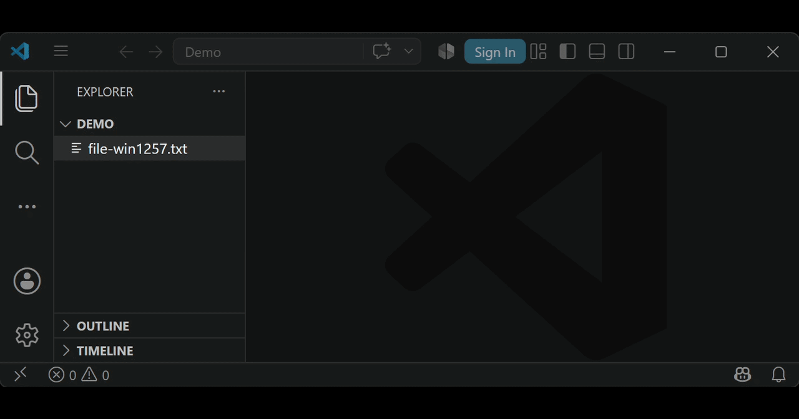

# Encoding Rules

A VS Code extension that automatically opens files with the correct encoding based on file path rules.

Useful for legacy projects, imported files, and repositories that contain a mix of UTF-8 and non-UTF-8 text files.

<p align="center">
  
</p>

## Features

- Automatically detects matching files when they are opened.
- Applies a configured encoding based on file path patterns.
- Works with path-based rules using glob patterns.
- Helps with legacy files that need a specific encoding.
- Keeps encoding decisions in VS Code settings.

## Commands

Encoding Rules provides the following commands through the VS Code Command Palette.

| Command | Description |
|---|---|
| **Encoding Rules: Create Rule for Current File** | Creates an encoding rule for the currently active file. Choose an encoding from the list or enter a custom encoding. If a matching rule already exists, you can replace it. |
| **Encoding Rules: Create Rule for Current Folder** | Creates an encoding rule for the folder containing the currently active file. The rule applies to files matching that folder path. |
| **Encoding Rules: Show Matching Rule** | Shows the encoding rule currently matching the active file, including the encoding and matching path pattern. |

You can run these commands by opening the **Command Palette** with `Ctrl+Shift+P` (`Cmd+Shift+P` on macOS) and searching for **Encoding Rules**.

## Configuration

Add encoding rules in your VS Code settings:

```json
{
  "encodingRules.rules": {
    "windows1257": [
      "**/legacy/**"
    ],
    "utf8": [
      "**/*.txt"
    ]
  }
}
```

Each rule contains:

| Property | Description |
| --- | --- |
| `pattern` | File path pattern to match |
| `encoding` | Encoding to use when opening the file |

## Supported Encodings

Supported encodings depend on VS Code's built-in encoding support.

Common examples:

- `utf8`
- `utf8bom`
- `windows1252`
- `shiftjis`
- `gbk`
- `gb18030`

## Glob Patterns

Rules use glob patterns to match files.

Examples:

### Match all text files

```
**/*.txt
```

Matches all `.txt` files.

### Match files in a folder

```
**/legacy/**
```

Matches all files inside folders named `legacy`.

### Match files inside a source folder

```
src/**/*.c
```

Matches C files inside `src` and its subfolders.

## Why?

Many projects still contain files created with older tools and different character encodings.

Manually selecting:

```
File → Reopen with Encoding
```

every time a file is opened is repetitive and easy to forget.

Encoding Rules lets you define these choices once.

## Known Limitations

- Encoding detection is not performed. Rules are based on file paths.
- Incorrect rules may cause files to be opened with the wrong encoding.
- Some VS Code internal documents may not have normal file paths.
- The extension does not modify file contents; it only controls how files are opened.

## Support

If Encoding Rules saves you time, consider supporting development:

<a href="https://www.buymeacoffee.com/productivityplusplus">
  
</a>

<a href="https://github.com/sponsors/ProductivityPlusPlus">
  
</a>


## License

MIT License